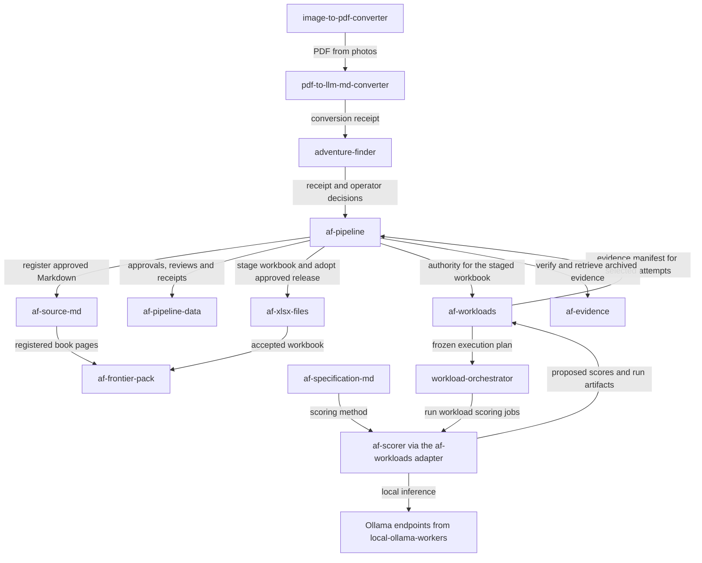
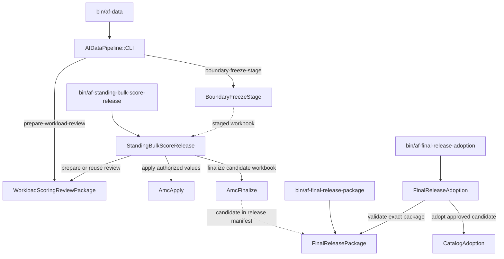

# AF Pipeline

AF Pipeline takes a book from page-marked Markdown to an approved update of the
Adventure Finder catalog. It records which source pages belong to each adventure,
stages those entries in a workbook, and checks scoring evidence against that exact
workbook. The result is a release candidate a reviewer can inspect before making
it the current catalog.

**Setting up your own library?** Pair this public code checkout with a private
`af-pipeline-data` repository in your own account. Keep pipeline approvals, review
ledgers, authority records, release candidates, and receipts there. The book text
and the accepted catalog each have their own store. [Set up your own private repositories](https://github.com/dtnorris/adventure-finder#set-up-your-own-private-repositories)

To explore before setting up a private store, follow [one workbook through the integration test](test/integration/public_pipeline_test.rb), or [try Adventure Finder with a public sample catalog](https://github.com/dtnorris/adventure-finder#try-the-public-sample).

## Where the pipeline fits

Follow one book through the system. The arrows name the artifacts or work that
cross a component boundary. Adventure Finder coordinates the operation and
collects the operator's decisions.



- **During scoring**, AF Workloads (AFW) freezes the selected cases and publishes their evidence. Workload Orchestrator (WLO) runs the plan and owns attempt selection. For local execution, the scorer uses endpoints made ready by Local Ollama Workers. [Scoring and worker architecture](https://github.com/dtnorris/adventure-finder#scoring-architecture)
- **After scoring**, the AFW manifest identifies the evidence for review. The separate evidence archive holds bundles and manifests in `af-evidence-data`. To explore that store independently, try the [public evidence walkthrough](https://github.com/dtnorris/af-evidence/blob/5e9e28dc981ddb670eddcaaf1e30357bbb152a0b/README.md#store-and-retrieve-your-first-member).

## Inside the Ruby code

Start in [bin/](bin) for the command an operator runs and [lib/af_data_pipeline/](lib/af_data_pipeline) for its implementation. This map shows how two command paths share the same review code and where the guarded catalog write happens. Dotted arrows carry artifacts between commands.



| If you want to follow… | Start here | What to look for |
| --- | --- | --- |
| A book entering the pipeline | [SourceProgression](lib/af_data_pipeline/source_progression.rb) and [IngestNext](lib/af_data_pipeline/ingest_next.rb) | `bin/af-source-progress` advances a bound input toward boundary review. `bin/af-ingest-next` reports the next action for a supplied artifact. |
| Approval to score a staged workbook | [BoundaryFreezeStage](lib/af_data_pipeline/boundary_freeze_stage.rb) and [StagedScoringAuthority](lib/af_data_pipeline/staged_scoring_authority.rb) | Staging produces a workbook, apply report, and receipt. `bin/af-staged-scoring-authority issue` binds the approval and scoring intent that AFW checks before compiling. |
| Evidence becoming a candidate | [WorkloadScoringReviewPackage](lib/af_data_pipeline/workload_scoring_review_package.rb) and [StandingBulkScoreRelease](lib/af_data_pipeline/standing_bulk_score_release.rb) | The AFW manifest and its data root identify the review inputs. The standing release prepares or reuses the review, applies eligible values, and records holds and gaps. |
| The current catalog changing | [FinalReleaseAdoption](lib/af_data_pipeline/final_release_adoption.rb) and [CatalogAdoption](lib/af_data_pipeline/catalog_adoption.rb) | A reviewer approves the exact final package. `adopt` revalidates it before updating `catalog_head`. Replaying that completed adoption returns `ALREADY_PROMOTED`. |

For the individual source and boundary decisions, start with `bin/af-source-intake`, `bin/af-source-register decide` and `apply-approved`, then `bin/af-boundary-editorial` to record approval and freeze the boundaries. The [library ingest runbook](docs/LIBRARY_INGEST_RUNBOOK.md) lists the inputs for each command.

## Set up a checkout

Use Ruby 4.0, Bundler 4.0.17, Git, zstd, and unzip. Clone the public components at the revisions in [config/public_owners.tsv](config/public_owners.tsv). Export each selector in the first column as the absolute path to its checkout. From the pipeline root, install and check the locked dependencies:

```sh
BUNDLE_FROZEN=true bundle install
bash bin/setup
```

| What you are selecting | How to select it |
| --- | --- |
| Public pipeline code | External callers set `AF_DATA_PIPELINE_ROOT` to this checkout. The Ruby namespace is `AfDataPipeline`. Existing documents retain the `af-data-pipeline` owner identifier. |
| Private pipeline records | Set `AF_DATA_PIPELINE_DATA_ROOT` to the existing, writable, absolute path of your `af-pipeline-data` checkout, outside the code checkout. |
| Books and catalog | Select `af-source-md-data` with `--source-root` and `af-xlsx-files-data` with `--catalog-root` where applicable. Set `AF_PROJECT_STATE` or pass `--manifest` for commands that resolve catalog roles. |
| Frozen workloads and evidence for review | AFW takes its own `--data-root` and scorer configuration. Use `AF_AFW_DATA_ROOT` for `af-ingest-next` routing. Pass the published AFW manifest and its data root to `bin/af-data prepare-workload-review`. |

## Which document should I open?

| I want to… | Read |
| --- | --- |
| Decide which pages form an adventure or resume an ingest | [Library ingest runbook](docs/LIBRARY_INGEST_RUNBOOK.md) for intake, registration, and boundary review. [Next-action router](docs/INGEST_NEXT.md) to resume from an artifact you already have. |
| Understand what AFW is allowed to score | [Verified staged successor](docs/VERIFIED_STAGED_SUCCESSOR_V0.1.md) for the workbook and receipt. [Staged-scoring authority](contracts/staged-scoring/v0.1/README.md) and the [AFW compiler contract](https://github.com/dtnorris/af-workloads/blob/6b9b1fa80cd20c24851abea6e91362767c5af3f7/docs/AFW_FORWARD_WORKLOADS.md#staged-authority) for the handoff. |
| Turn returned scores into a reviewable workbook | [Scoring and review runbook](docs/operator-runbook.md) for the standing-directive workflow and the alternative individual-review ledger. [Standing bulk score release](docs/STANDING_BULK_SCORE_RELEASE_V0.1.md) for the candidate and its accounting. |
| Decide whether a release can become the current catalog | [Final release package](docs/FINAL_RELEASE_PACKAGE_V0.1.md) for approval, decline, adoption, and replay. [Project state](docs/PROJECT_STATE.md) for catalog roles and guarded updates, including reviewed manual adoption. |
| Find which files to retain and where they belong | [Private operational data root and ownership inventory](docs/architecture.md#private-operational-data-root) for pipeline outputs and externally owned stores. |

## Validate

With the pinned components selected, run `bundle exec rake test:contract` and
`bundle exec rake test:integration`. Buildkite runs both against clean public
owner checkouts. The [end-to-end test](test/integration/public_pipeline_test.rb)
follows one staged workbook through scorer preflight, AFW evidence publication,
review, release, and cold adoption replay. It supplies synthetic execution and
scoring results, so you can trace the handoffs without running a model.

See [LICENSE](LICENSE) and [THIRD_PARTY_NOTICES.md](THIRD_PARTY_NOTICES.md).
